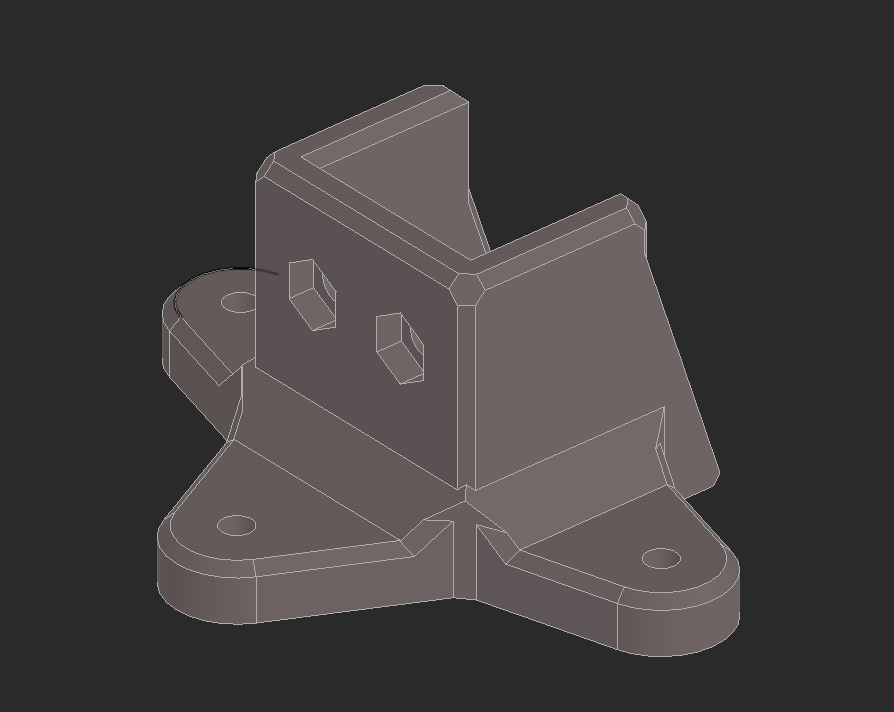

# BTT Eddy Coil bed stand

Temporary stand for the BTT Eddy coil. Place it on the bed for calibration, then remove it.

Requires 3 magnets: 6 mm diameter, 2 mm thick.

Parametric Fusion 360 source: `eddy_coil_bed_stand.f3d`. STEP export: `eddy_coil_bed_stand.step`.
